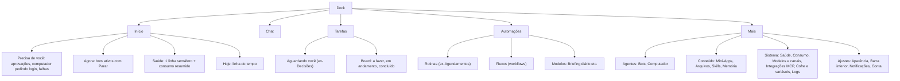

# Auditoria de UI/UX: Agent Control (PWA), 22/11/2026

Autor: bot **Design**. Escopo: **só análise** (nenhum código alterado, nenhum deploy).

**Como foi feito**
- Rodei o painel localmente (`server.js` na porta 3901, ligado à ponte real, `dist/` de 22/11 15:52, mesmo build da produção) e tirei prints com Chromium headless em **390×844 @2x**, dock igual ao do Caio (Centro · Chat · Decisões · Mais · Buscar).
- Prints: `/home/node/workspace/prints/ux-audit/` (`<tela>-1.png` = topo, `<tela>-2.png` = rolado, `modal-busca.png`, `modal-decisoes.png`).
- Também usei os prints do Caio (IMG_2368 Chat, IMG_2369 Tarefas) e li o código em `src/`.

> [!NOTE]
> No ambiente local o Coolify aparece como "Unauthenticated." porque minha instância não tinha `COOLIFY_TOKEN`. Isso não é bug de produção, mas mostra como a mensagem de erro aparece crua (ver Painel/Logs).

> [!IMPORTANT]
> Dois bugs dos prints do Caio **já foram corrigidos** no build atual: `a037550` (chips de sugestão vazando) e `d3d2485` (metadados do card "Monitoramento automático" espremidos numa coluna). No print novo `board-1.png` o card já aparece certo. Vale ele confirmar no iPhone depois de atualizar o PWA.

Legenda: **Impacto** alto/médio/baixo · **Esforço** P (horas) / M (1–2 dias) / G (3+ dias)

---

## 1. Diagnóstico geral: arquitetura de informação e navegação

### 1.1 O que faz o Caio se perder

1. **São 18 telas numa lista plana, sem grupos.** `PAGES` em [App.jsx#L33-L52](file:///home/node/workspace/agent-control-panel/src/App.jsx#L33-L52) vira a lista do "Mais" ([App.jsx#L237-L246](file:///home/node/workspace/agent-control-panel/src/App.jsx#L237-L246)) e a sidebar no desktop ([App.jsx#L576](file:///home/node/workspace/agent-control-panel/src/App.jsx#L576)). Não tem seção, nem subtítulo, e a ordem não segue frequência de uso: "Estado" e "Fluxos" aparecem antes de "Tarefas".
2. **Três telas de "visão geral" que se sobrepõem:**
   - *Centro* (`command`): bots + linha do tempo.
   - *Painel* (`overview`): container, ponte, totais, execuções, ações do Coolify, conversas e envio de WhatsApp.
   - *Estado* (`status`): semáforos.

   Todas repetem "em execução", ponte e ai-memory. Os nomes Centro, Painel e Estado não dizem qual é qual.
3. **Nomes ambíguos ou que colidem:**
   - "Páginas" é o nome de uma tela (`nav.dashboards`) **e também** o título da seção do Mais (`nav.pages`), ver [i18n.jsx#L35](file:///home/node/workspace/agent-control-panel/src/i18n.jsx#L35) e [#L120](file:///home/node/workspace/agent-control-panel/src/i18n.jsx#L120). O resultado é o item "Páginas" dentro da seção "PÁGINAS".
   - "Tarefas" e "Board" são a mesma coisa: a busca mostra "Tarefas (Board)", o inglês usa "Board" e os bots dizem "Board".
   - "Decisões" não explica o que tem dentro (aprovações, rascunhos, revisões). Ao lado de "Tarefas", não fica claro onde está "o que preciso fazer".
   - Providers e MCP são jargão em inglês. "Variáveis" abre primeiro o **Cofre**.
4. **Funções duplicadas em telas diferentes:**
   - Workflows: dá para editar na tela *Fluxos* **e** num card dentro de *Agendamentos* ([Schedules.jsx#L167](file:///home/node/workspace/agent-control-panel/src/pages/Schedules.jsx#L167), [#L204](file:///home/node/workspace/agent-control-panel/src/pages/Schedules.jsx#L204)).
   - Lista de bots: aparece em Centro e em Bots.
   - Busca e Decisões: estão na dock e de novo em "Atalhos rápidos" no Mais.
   - O avatar abre um sheet com **exatamente** o mesmo conteúdo da aba Mais.
   - Providers tem as abas "Automação", "Canais" e "Conversas", que são ajustes gerais e não têm a ver com provedores ([Providers.jsx#L457](file:///home/node/workspace/agent-control-panel/src/pages/Providers.jsx#L457)).
5. **A busca (Cmd+K) não navega.** Ela procura só conteúdo (chats, tickets, páginas, memória…) ([GlobalCommandHub.jsx#L8-L18](file:///home/node/workspace/agent-control-panel/src/GlobalCommandHub.jsx#L8-L18)). Digitar "agendamentos" ou "nova tarefa" não leva à tela nem dispara a ação, embora a tela Estado diga que o atalho "abre a busca e a paleta de comandos" ([Status.jsx#L55](file:///home/node/workspace/agent-control-panel/src/pages/Status.jsx#L55)). Com o campo vazio, só aparece um texto de dica, sem recentes nem sugestões.
6. **Não há onboarding nem explicação das funções.** Nenhuma tela tem "o que é isto". A intro de página (`page-intro`) só aparece no desktop (ex.: [Board.jsx#L330](file:///home/node/workspace/agent-control-panel/src/pages/Board.jsx#L330)). Estados vazios como Fluxos ("Nenhum workflow ainda") não explicam a função nem oferecem modelo.
7. **A dock pode deixar o usuário sem saída (bug).** `MIN_DOCK = 1` e `normalizeDock` aceitam uma dock só com ações ([DockSettings.jsx#L6-L16](file:///home/node/workspace/agent-control-panel/src/DockSettings.jsx#L6-L16)). A preferência salva para o login por senha hoje é `{"dock":["search","inbox"]}`, e com ela a dock fica só com **Buscar + Decisões**, sem nenhuma aba de tela e sem "Mais" (ver `chat-1.png`). Navegar fica quase impossível.
8. **A dock de vidro atrapalha a leitura.** Em quase todos os prints o texto da lista aparece por baixo dos rótulos da dock (ex.: "Permitir Busca Global" misturado com "Chat/Decisões" em `board-1.png`, `status-1.png`, `skills-1.png`). Falta opacidade ou blur suficiente, e falta um fade de conteúdo atrás da dock.
9. **Ícones não carregam informação.** Board, Agendamentos, Skills e MCP usam o mesmo ícone e a mesma cor em todas as linhas. No Board, a cor vem da **prioridade** ([Board.jsx#L307](file:///home/node/workspace/agent-control-panel/src/pages/Board.jsx#L307)), por isso itens concluídos de prioridade alta ficam **laranja**, como se estivessem em andamento.
10. **Idioma inconsistente.** Command, Status, GlobalCommandHub e partes de Schedules têm texto em pt-BR fixo, fora do i18n. Erros chegam crus em inglês ("Unauthenticated."), e as descrições de skills estão em inglês.

### 1.2 Nova estrutura proposta

Princípio: **5 destinos fixos, organizados por intenção**, e o resto agrupado no Mais com subtítulo de uma linha.

**Novos nomes (de → para)**
- Centro + Painel + Estado → **Início**. Os detalhes técnicos do Painel (container, redeploy) vão para **Sistema › Saúde**.
- Decisões → **Aguardando você** (ou "Aprovações"), como 1ª seção de Tarefas e card no Início, com badge de contagem. Se o Caio quiser, continua podendo ficar como atalho na dock.
- Tarefas/Board → **Tarefas** em todo lugar (UI, busca, EN = "Tasks").
- Agendamentos + Fluxos (+ card Briefing) → **Automações**, com abas Rotinas | Fluxos | Modelos.
- Páginas (dashboards) → **Mini-Apps**. A seção "Páginas" do Mais passa a se chamar "Telas" ou é substituída pelos grupos acima.
- Artefatos → **Arquivos**. Providers → **Modelos e canais**. MCP → **Integrações (MCP)**. Variáveis → **Cofre e variáveis**. Estado → **Saúde do sistema**.
- Busca: deixa de ser só um botão na dock. Vira um campo no topo de Início/Mais (pull-down estilo iOS) e continua no Cmd+K, agora como **paleta**: telas + ações + conteúdo.
- Avatar: abre **só Conta/Ajustes**, e não uma cópia do Mais.

**Descoberta e onboarding**
- Cada item do Mais ganha um subtítulo curto (ex.: "Rotinas: tarefas que rodam sozinhas em horários").
- Primeiro acesso: 3 cartões ("Converse com seus bots", "Aprove o que eles pedem", "Automatize rotinas"), sem bloquear o uso e com opção de pular.
- Estados vazios com 1 frase explicando a função, 1 CTA e um link "ver exemplo/modelo".

---

## 2. Tela por tela

### Chat (`Chat.jsx`, print IMG_2368, `chat-1.png`)
- **O header flutua sobre o texto.** A cápsula (ligar/novo/…) e o avatar ficam por cima das mensagens sem fundo, e o texto aparece cortado por baixo ([Chat.jsx#L1712-L1730](file:///home/node/workspace/agent-control-panel/src/pages/Chat.jsx#L1712-L1730)). O título da conversa some no mobile.
  → Barra com material de vidro e *scroll-edge* (blur + gradiente) atrás do header. Título centralizado e truncado; tocar no título abre as opções da conversa. **Alto · P**
- **Ações demais no header mobile.** Ligação, novo e "…" mais o avatar. → Deixar só ☰ · título · ✏️ e mover "Ligação" para o "…" (é uso raro). **Médio · P**
- **Metadados da resposta poluem a mensagem.** "Antigravity · 1.3 min · 1 passos · ~US$ 0,0917 · ▶ · fork" e mais uma linha com 🏳 ↩ ⧉ ([Chat.jsx#L955](file:///home/node/workspace/agent-control-panel/src/pages/Chat.jsx#L955)). → Mostrar só a hora e um "ⓘ" discreto. Detalhes (provedor, custo, passos) num popover; ações no long-press (que já existe) ou só na última mensagem. Corrigir "1 passos" → "1 passo". **Médio · P**
- **Sugestões rápidas.** O vazamento foi corrigido (`a037550`), mas 3 cartões com borda de largura total ocupam ~⅓ da tela ([Chat.jsx#L1790-L1799](file:///home/node/workspace/agent-control-panel/src/pages/Chat.jsx#L1790-L1799)). → Chips só com o rótulo numa linha com rolagem horizontal (descrição no long-press ou em no máximo 1 linha), e esconder quando o usuário começar a digitar. **Médio · P**
- **O composer mostra o provedor ("opencode/…" truncado) em vez do bot.** → A pílula mostra avatar + nome do bot ativo (o que importa para o Caio), e provedor/modelo ficam dentro dela. A câmera duplica o "+": juntar os dois no "+" (Foto, Câmera, Arquivo). **Médio · P**
- **Estado "trabalhando… 12s".** O spinner parece um "C" solto. → Usar o avatar do bot com anel animado, "Design está pensando… 12s" e um botão Parar visível ali. **Baixo · P**
- **Gaveta de conversas.** Abas Conversas/Atividade e "Apagar todas" logo depois da lista ([Chat.jsx#L1680-L1684](file:///home/node/workspace/agent-control-panel/src/pages/Chat.jsx#L1680-L1684)). → Levar "Apagar todas" para um menu "…" com confirmação. "Atividade" combina mais com o Início. **Médio · P**

### Centro / Command (`Command.jsx`, `command-1/2.png`)
- **16 cartões de bot em largura total, quase todos "ocioso".** A linha do tempo fica a 3 telas de rolagem ([Command.jsx#L118-L123](file:///home/node/workspace/agent-control-panel/src/pages/Command.jsx#L118-L123)). → Bots ativos em cartões no topo; ociosos numa grade compacta de avatares (4–5 por linha) ou carrossel. **Alto · P**
- **Stats sem ação.** "Aprovações pendentes 0" não é clicável. → Tornar clicáveis (abre Aguardando você / Em execução) e trocar por um card "Precisa de você" que só aparece quando há algo. **Alto · P**
- Vira a base do novo **Início** (juntar com Painel e Estado). **Alto · M**

### Painel / Overview (`Overview.jsx`, `overview-1/2.png`)
- **IDs crus para o usuário.** "deleg:1edb2f5bdb2d", "Web" ([Overview.jsx#L66](file:///home/node/workspace/agent-control-panel/src/pages/Overview.jsx#L66)). → "Delegação: Agent → Design", "Chat web: <título>". **Médio · P**
- "85619.1 min de trabalho" → "59 d de trabalho". Versão "va7ac3ea" (prefixo "v" num hash) → "build a7ac3ea". **Baixo · P**
- **Tela de miscelânea.** Mistura status, totais, ações perigosas (Reiniciar/Redeploy), lista de conversas e formulário de WhatsApp. → Status vai para Saúde, Reiniciar/Redeploy para Sistema (com confirmação, que já existe), conversas para o Chat e "Enviar WhatsApp" para uma ação na paleta/Chat. Depois disso, a tela some. **Alto · M**
- **Erro cru** "Coolify: Unauthenticated." → mensagem humana + ação ("Token do Coolify inválido. Ver em Cofre e variáveis"). **Médio · P**

### Estado / Status (`Status.jsx`, `status-1/2.png`)
- Os semáforos funcionam bem, mas as 12 linhas têm o mesmo peso. → Problemas no topo, OKs recolhidos ("9 serviços OK ▸"). Tocar numa linha leva à tela certa (Coolify → Logs/Variáveis, Provedor → Modelos, Orçamento → Consumo). **Médio · P**
- Rotinas fixas por ID no código (`b80f57`, `c772db`, `41f73f`) ([Status.jsx#L45](file:///home/node/workspace/agent-control-panel/src/pages/Status.jsx#L45)): é frágil. → Marcar rotinas como "críticas" em Automações. **Baixo · M**
- "Orçamento do mês" fica por baixo da dock (falta padding inferior). **Baixo · P**

### Tarefas / Board (`Board.jsx`, IMG_2369, `board-1/2.png`)
- **Cor e ícone vêm da prioridade, não do status.** Concluídos de prioridade alta ficam laranja ([Board.jsx#L307](file:///home/node/workspace/agent-control-panel/src/pages/Board.jsx#L307)). → Ícone por status: a fazer ○ cinza, em andamento ◔ azul animado, revisão 👁 roxo, bloqueado ⚠ vermelho, concluído ✓ verde. Prioridade fica só no badge, e **sem badge** em concluídos. **Alto · P**
- **"Concluído · 38" ocupa a tela inteira.** → Mostrar 5 e "Ver todos (38)", ou um filtro segmentado Abertas | Concluídas no topo. **Alto · P**
- **Título truncado cedo** ("Validar remoção de de…") por causa do badge. → Título em até 2 linhas e badge de prioridade como ponto colorido ou na linha de metadados. **Médio · P**
- **Card "Monitoramento automático".** O layout foi corrigido, mas o conceito confunde: com o toggle desligado aparecia "4 rodando". → Renomear para "Executor automático da fila" e explicar no subtítulo ("pega a próxima tarefa a cada 10 min"). Separar "rodando agora (manual)" do estado do executor. Recolher num disclosure quando desligado. **Médio · P**
- **"Aguardando você"** (Decisões) entra como 1ª seção da tela. **Alto · M**

### Decisões / ActionInbox (`GlobalCommandHub.jsx`, `modal-decisoes.png`)
- O botão de fechar diz "Cancelar", mas nada foi iniciado. → "Fechar" ou "OK". **Baixo · P**
- "Novo rascunho" dentro de uma caixa de aprovação é estranho. → Mover para a paleta/Chat ("Novo rascunho de WhatsApp/e-mail"). **Baixo · P**
- É um modal e não uma tela: some ao trocar de aba e não tem URL. → Virar seção de Tarefas/Início (tela navegável, com deep-link `#/tarefas/aguardando`). **Médio · M**

### Busca global / Cmd+K (`GlobalCommandHub.jsx`, `modal-busca.png`)
- **Não navega por telas nem executa ações** ([GlobalCommandHub.jsx#L8-L18](file:///home/node/workspace/agent-control-panel/src/GlobalCommandHub.jsx#L8-L18)). → Adicionar os grupos "Telas" (todas as 18, com sinônimos: "board"→Tarefas, "cron"→Rotinas, "cofre"→Variáveis) e "Ações" (Nova conversa, Nova tarefa, Nova rotina, Ligar computador, Enviar WhatsApp). Resultados locais na hora, conteúdo remoto depois. **Alto · M**
- **Placeholder enorme e truncado** ([#L115](file:///home/node/workspace/agent-control-panel/src/GlobalCommandHub.jsx#L115)). → "Buscar telas, conversas, tarefas…". **Baixo · P**
- **Estado vazio só com texto** ([#L137-L140](file:///home/node/workspace/agent-control-panel/src/GlobalCommandHub.jsx#L137-L140)). → Recentes (últimas 5 telas/itens abertos) e ações sugeridas. **Médio · P**

### Mais / MoreList (`App.jsx`, `more-1/2.png`)
- **Lista plana de 16 itens sem explicação.** → Agrupar (Agentes / Conteúdo / Sistema / Ajustes) com subtítulo de 1 linha em cada item, e manter a ordem por frequência. **Alto · P**
- **"Atalhos rápidos" repete o que já está na dock** ([App.jsx#L223-L236](file:///home/node/workspace/agent-control-panel/src/App.jsx#L223-L236)). → Mostrar só o que **não** está na dock, ou trocar por um campo de busca no topo. **Médio · P**
- **Colisão "PÁGINAS › Páginas"** (ver 1.1). **Médio · P**
- Notificações bloqueadas aparecem só como texto. → Botão "Como liberar no iPhone" (passo a passo PWA). **Baixo · P**

### Barra inferior / DockSettings (`DockSettings.jsx`)
- **Bug: aceita dock só com ações** e então some a navegação (ver 1.1, item 7). → Validar: pelo menos 1 tela e "Mais" sempre acessível (se não estiver na dock, mostrar um botão "Mais" no header). Corrigir a preferência atual `password` = `["search","inbox"]`. **Alto · P**
- Legibilidade (item 8). → `--dock-bg` mais opaco (≥ 80% no claro), blur maior e `padding-bottom` das telas = altura da dock + safe-area + 16px. **Alto · P**

### Bots (`Bots.jsx`, `bots-1/2.png`)
- A lista está boa (avatar, nome, descrição). Falta **estado** (ativo/ocioso, última execução) e um atalho "Conversar". → Badge de estado e swipe "Conversar / Editar". **Médio · P**
- As descrições cortadas em 2 linhas misturam detalhes técnicos (e-mail, Andritz…). → Campo "resumo curto" separado das instruções. **Baixo · P**

### Consumo / Usage (`Usage.jsx`, `usage-1/2.png`)
- É a tela mais clara do app. Ajustes:
  - "Teto US$ 50.000,00 (1%)" parece um valor placeholder: confirmar o teto real ou esconder quando não houver teto.
  - Rótulos "PRO" e "GOOGLE AI PRO" em caixa alta competem com o título da seção.
  - A seção "Por bot" fica atrás da dock.

  **Baixo · P**
- Levar um resumo (sessão Claude %, gasto do mês) para o Início. **Médio · P**

### Agendamentos / Schedules (`Schedules.jsx`, `schedules-1/2.png`)
- **Cron cru como informação principal** ("0 6-23 * * *"). → Texto humano: "Todo dia às 04:00", "De hora em hora, 6h–23h", com o cron só no detalhe. **Alto · P**
- **Títulos truncados pelo badge "sem novidade".** → Badge como ícone/ponto ou na linha de metadados. Título em 2 linhas. **Médio · P**
- **Mesmo ícone laranja em todas as linhas.** → Ícone por tipo: ⏰ cron, 🔗 webhook, 👁 watch, 1× única; cor por saúde (verde ok, vermelho falha, cinza pausada). **Médio · P**
- **Card "Briefing Diário Personalizado" com "Ativar"** mesmo com o briefing já ativo na lista ([Schedules.jsx#L194](file:///home/node/workspace/agent-control-panel/src/pages/Schedules.jsx#L194)). → Virar "Modelos" (galeria) e mostrar "Ativo ✓" quando já existir. **Médio · P**
- **Card "Workflows Multi-Etapa" duplicado com a tela Fluxos.** → Remover daqui (Automações › Fluxos). **Médio · P**

### Fluxos / Workflows (`Workflows.jsx`, `workflows-1.png`)
- **Estado vazio pobre** e título "Editor de workflows" diferente do nome da tela. → Explicar ("Encadeie bots, condições e aprovações; ex.: triagem de e-mail → aprovação → envio"), botão "Começar de um modelo" + "Em branco". **Médio · P**
- Juntar com Agendamentos em **Automações**. **Alto · M**

### Páginas / Dashboards + PageTemplates (`Dashboards.jsx`, `dashboards-1.png`)
- **3 CTAs de criação empilhados** (Modelos, Novo Mini-App, Nova página) e um card-dentro-de-card com o título repetido "Páginas (2)". → Um só "+" no header com menu (Mini-App com IA, Página em branco, A partir de modelo) e lista sem o card externo. **Médio · P**
- **7 botões só com ícone por item** (abrir, externo, dados, cadeado, código, histórico, apagar), sem rótulo e com o apagar em vermelho fácil de tocar. → "Abrir" + "…" (Compartilhar, Dados, Código, Versões, Apagar). **Alto · P**
- Emoji desalinhado com o ícone; chips de metadados (slug, bot, 16 h, 2 KB) ocupam 2 linhas. → Uma linha de metadados com " · ". **Baixo · P**
- Renomear a tela para **Mini-Apps**. **Médio · P**

### Skills (`Skills.jsx`, `skills-1/2.png`)
- **Nome truncado e slug repetido no badge** ("web-desig… /web-design-guidelines"). → Mostrar só o nome completo (é o próprio slug) e tirar o badge. **Médio · P**
- **Descrições em inglês e mesmo ícone em todas.** → Descrição traduzida (campo pt-BR) e ícone/cor por origem (builtin, aprendida, instalada). **Baixo · M**

### Memória + Grafo (`Memory.jsx`, `MemoryGraph.jsx`, `memory-1.png`)
- **4 camadas de filtro** (fonte · workspace · tipo · busca) antes do conteúdo. O padrão "Fatos 1" mostra quase nada enquanto existem 181 sessões. → Padrão "Tudo" ordenado por recente; workspace dentro de um botão de filtro; "Grafo" como botão no header. **Médio · P**
- Jargão ("fact", "workspace (183)", "ai-memory" vs "Memória interna"). → "Fato", "Projeto", "Memória do agente" vs "Memória dos bots". **Baixo · P**

### MCP (`Mcp.jsx`, `mcp-1/2.png`)
- **O comando cru é a informação principal**, e cada servidor aparece duas vezes (Claude Code e Antigravity). → Uma linha por servidor com o estado (● conectado/erro) e chips "Claude · Antigravity". Comando/URL só no detalhe. **Médio · M**
- "Testar conexões" perdido entre as seções. → Botão no header que atualiza o estado de cada linha. **Baixo · P**

### Variáveis / Envs (`Envs.jsx`, `envs-1/2.png`)
- **O nome "Variáveis" abre no "Cofre".** → Renomear para **Cofre e variáveis**. **Médio · P**
- **Parágrafo técnico longo no topo** (AES, 0600, TOTP…). → 1 linha + "ⓘ Como funciona". **Baixo · P**
- **Lixeira vermelha em cada linha** e chips "api_key", "default" e máscara competindo. → Apagar só no detalhe/swipe; metadados numa linha só. **Médio · P**

### Providers (`Providers.jsx`, `providers-1/2.png`)
- **As abas "Automação / Canais / Conversas" não são de provedores** ([Providers.jsx#L457](file:///home/node/workspace/agent-control-panel/src/pages/Providers.jsx#L457)). → Levar para **Ajustes** (Canais = WhatsApp/Telegram; Automação = executor/limites) e deixar a tela como **Modelos e canais** ou só **Modelos**. **Alto · M**
- **O estilo das abas** (pílula azul cheia) é diferente do segmented control das outras telas (Logs, Memória, Agendamentos). → Padronizar com `.seg`. **Baixo · P**
- **Labels técnicos** ("CLAUDE_CODE_OAUTH_TOKEN", "bypassPermissions"). → Rótulo humano ("Assinatura Claude", "Sem pedir permissão") com o valor técnico em fonte menor. **Baixo · P**

### Computador (`Computer.jsx`, `computer-1/2.png`)
- **Desligado, a área preta ocupa a tela toda** e empurra Status/Ações para baixo da dobra. → Desligado: card compacto (ícone, 1 linha, "Ligar"). Ligado: tela grande. **Médio · P**
- O texto cinza sobre preto ("O computador inicia sob demanda…") tem contraste baixo (< 4.5:1). **Médio · P**

### Artefatos (`Artifacts.jsx`, `artifacts-1/2.png`)
- **"Remover todos" em vermelho ao lado do filtro**: um toque errado é caro. → Mover para "…" com confirmação digitada. **Alto · P**
- Prints com miniatura cortada em cards altos (1 por tela). → Grade de 2–3 colunas para imagens e lista compacta para arquivos/áudios. **Médio · M**
- "Artefatos (274)" repete o título grande. → Mostrar o total só na linha "274 arquivos · 139,7 MB". **Baixo · P**

### Logs (`Logs.jsx`, `logs-1/2.png`)
- **Ações desabilitadas em azul-claro** (Copiar/Baixar) parecem links, com contraste baixo. → Cinza + motivo ("sem logs"). **Baixo · P**
- **Erro cru** "Unauthenticated." e "(vazio)". → Mensagem humana + link para o Cofre. Estado vazio explicado. **Médio · P**
- O ícone do toggle "ao vivo" (círculo verde) parece um status, e não um controle. → Ícone de rádio/onda e rótulo "Atualizar ao vivo". **Baixo · P**

### Login (`Login.jsx`)
- Não foi auditado em profundidade (precisaria deslogar). Ponto rápido: garantir que o seletor de idioma/tema não compete com o botão Google/senha. **Baixo · P**

### Transversais
- **i18n**: mover os textos fixos de Command, Status, GlobalCommandHub e Schedules para `i18n.jsx`. **Baixo · M**
- **Erros**: um helper `humanError()` que traduz 401/403/ECONNREFUSED/timeout e sugere a ação. **Médio · P**
- **Ícones com significado**: status ou tipo em vez de um ícone decorativo repetido (Board, Agendamentos, Skills, MCP). **Médio · P**
- **Desktop**: a sidebar com as mesmas 18 entradas soltas ([App.jsx#L576-L588](file:///home/node/workspace/agent-control-panel/src/App.jsx#L576-L588)) → usar os mesmos grupos do Mais. **Médio · P**

---

## 3. Top 10 quick wins (em ordem de prioridade)

1. **Corrigir a dock "sem saída"**: exigir ≥ 1 tela na dock, sempre deixar "Mais" acessível e limpar a preferência `password` = `["search","inbox"]`. *Alto · P*
2. **Legibilidade da dock**: fundo mais opaco/blur e `padding-bottom` correto nas telas, para o conteúdo não aparecer por baixo dos rótulos. *Alto · P*
3. **Board por status**: ícone e cor por status (concluído = ✓ verde), sem badge de prioridade nos concluídos e "Concluído" recolhido em 5 + "Ver todos". *Alto · P*
4. **Mais agrupado e com subtítulos**: seções Agentes / Conteúdo / Sistema / Ajustes, 1 linha explicando cada tela e sem repetir o que já está na dock. *Alto · P*
5. **Renomear o que confunde**: Centro → Início, Decisões → Aguardando você, Páginas → Mini-Apps, Variáveis → Cofre e variáveis, Artefatos → Arquivos, seção "Páginas" → grupos. *Alto · P*
6. **Busca que navega**: incluir Telas + Ações (com sinônimos) e recentes no estado vazio, com placeholder curto. *Alto · M*
7. **Header do Chat com fundo de vidro**: título visível, "Ligação" dentro do "…" e metadados da resposta recolhidos em "ⓘ". *Alto · P*
8. **Centro enxuto**: bots ociosos em grade compacta, ativos no topo e stats clicáveis ("Precisa de você"). *Alto · P*
9. **Agendamentos legíveis**: cron em linguagem natural, ícone por tipo/saúde, sem o card Workflows duplicado e com o Briefing mostrando "Ativo ✓". *Médio · P*
10. **Ações destrutivas e secundárias em "…"**: Páginas (7 ícones → Abrir + …), Artefatos ("Remover todos"), Chat ("Apagar todas"), Cofre (lixeira por linha). *Alto · P*

**Depois dos quick wins (estrutural, M/G):** juntar Centro, Painel e Estado em **Início**; criar **Automações** (Rotinas + Fluxos + Modelos); transformar Decisões em seção navegável de Tarefas; levar as abas de ajustes de Providers para **Ajustes**; onboarding de 3 cartões.

> [!TIP]
> Próximo passo sugerido: eu monto um **protótipo navegável** (Página HTML) da nova navegação (Início, Mais agrupado, Board por status) para o Caio aprovar antes do `frontend` implementar. Os quick wins 1–3 e 7 podem ir direto para o `frontend`, porque são CSS/JSX pequenos.
